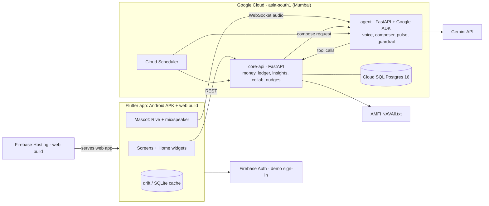

# Pocket — Architecture

Pocket is a finance app for India, built in Flutter: an Android app for building and testing, and a web build that judges open from a link. A live voice mascot builds each user's Home screen, explains their money in Tamil, Hindi or English, and helps groups share costs. **All MVP data is synthetic.**

---

## 1. The one rule

**Code owns every number. The AI only shapes words and layout.**

- Every amount on screen or spoken comes from `core-api`.
- The AI never adds, subtracts, averages or splits. If it needs a number, it calls a tool that returns it.

---

## 2. System map



| Service | Does | Never does |
| --- | --- | --- |
| `core-api` | All money maths, the database, insights, collab, nudges, data loading | Call an LLM |
| `agent` | Live voice, Home layout generation, Pulse news, guardrail | Touch the database or compute money |

The agent reaches money only through `core-api` internal endpoints. It authenticates with its Google service-account token and sends the user id in an `X-Pocket-User-Id` header.

---

## 3. The 13 parts

| # | Part | Where | Job |
| --- | --- | --- | --- |
| 1 | Mascot | Phone | Rive character with moods and lip-sync; streams voice to the agent |
| 2 | Generated Home | Phone | Renders the stored layout using only the 12 catalog widgets |
| 3 | Fixed screens | Phone | Onboarding, Money, Plan, Collab, Profile |
| 4 | Offline cache | Phone | drift (SQLite) copy of the last sync; the app opens without a network |
| 5 | Core API + ledger | core-api | The only place money maths runs |
| 6 | Insight engine | core-api | Finds patterns in code (overspend, creep, duplicates, idle cash…) |
| 7 | Collab service | core-api | Groups, shared budgets, pots, splits, balances, UPI settle-up links |
| 8 | Nudge service | core-api | In-app alerts: max 2 a day, quiet hours 22:00–08:00 |
| 9 | Synthetic data generator | shared Python package | Builds every dataset in §9 |
| 10 | Mascot agent | agent | Runs the live voice chat and calls tools |
| 11 | UI composer | agent | Turns what a person needs into a layout; rejects anything outside the catalog |
| 12 | Pulse | agent + core-api | Daily markets and world digest with sources, tied to the user's loans and holdings |
| 13 | Guardrail | agent | Catches personal buy/sell lines and numbers that don't match the ledger |

---

## 4. Tech stack (verified 20 Nov 2026)

| Layer | Pick | Notes |
| --- | --- | --- |
| App | Flutter (latest stable): Android (minSdk 26) + web | Package id `in.pocket.mvp`. Android for building and testing; the web build is the judge link. |
| App plumbing | Riverpod 3 · go_router · drift · dio · freezed · fl_chart | |
| Generated Home | **`a2ui_flutter` + `a2ui_core`, A2UI v1.0** | `genui`, `genui_a2a` and `genui_a2ui` are all **discontinued**. Do not use them. |
| Mascot | `rive` 0.14.x using **data binding (View Model)** | State-machine inputs are deprecated in 0.14.8 |
| Mic / speaker | `record` (PCM16 16 kHz stream, echo cancellation on) · `flutter_pcm_sound` (PCM16 24 kHz playback) | `flutter_pcm_sound` likely doesn't run in browsers: the web build plays the 24 kHz audio through a small Web Audio player behind the same interface |
| Voice model | `gemini-3.8-live` | **Audio-only replies.** Text comes from output transcription. No structured output. Don't send `thinking_config`. |
| Words and layouts | `gemini-3.8-flash`, thinking level `low` | `minimal` is rejected |
| Cheap checks | `gemini-3.8-flash` too (one model to manage) | |
| Agent framework | `google-adk` 2.x (Python), `Runner.run_live` + `LiveRequestQueue` | |
| Backend | Python 3.12 · FastAPI · Pydantic v2 · SQLAlchemy 2 async · Alembic · uv | |
| Database | Cloud SQL Postgres 16; **money as integer paise** | |
| Backend hosting | Cloud Run, asia-south1; `agent` min 1 instance, WebSocket timeout 3600 s, session affinity on | Deploy with `gcloud run deploy --source .` from a laptop |
| Frontend hosting | Firebase Hosting serves the Flutter web build | Static files only; it runs no backend code |
| Jobs | Cloud Scheduler calls each job endpoint | Nudges are shown inside the app, not pushed |
| Sign-in | Firebase Auth, **anonymous** sign-in behind a "Try a demo persona" button | No phone OTP in the MVP |
| Fund prices | AMFI `https://www.amfiindia.com/spages/NAVAll.txt` (real) | |
| News | Gemini + Google Search grounding (real) | |
| Synthetic data | Python · Faker `en_IN` · NumPy | |

Model IDs are config: `MODEL_LIVE`, `MODEL_FLASH`. Only the `agent` service holds `GEMINI_API_KEY`, as a Cloud Run environment variable. **Never put a key in the app or the web build:** anyone can read it there.

---

## 5. Data (core tables)

Money columns are `bigint` named `*_paise`. Times are `timestamptz` (UTC); budget logic runs in `Asia/Kolkata`.

| Table | Key fields |
| --- | --- |
| `users` | firebase_uid, language (en/hi/ta), mascot_voice, persona_id, income_pattern, onboarding_step |
| `user_settings` | nudge_daily_max (0–2), quiet_start/end, mute_voice |
| `profile_facts` | key (income, saving_for, worries…), value, source |
| `accounts` | institution, type (savings/current/credit_card/loan/wallet/cash), masked_number, balance_paise, interest_rate_bps |
| `transactions` | account, occurred_at, budget_month, amount_paise, personal_amount_paise, direction, mode (upi/card/cash/neft…), status, merchant, category, spend_class, ref_no, recurring_item_id, group_expense_id, source (aa/sms/manual) |
| `sms_messages` | sender_id, body, parse_status, parse_result, ground_truth |
| `merchants`, `categories` | ~300 merchants; ~38 fixed category slugs |
| `recurring_items` | kind (salary/rent/emi/bill/subscription/sip/insurance), amount, cadence, next_due_date |
| `loans`, `holdings`, `nav_prices` | EMIs; mutual funds (scheme_code, units), FDs, gold; daily NAV |
| `pockets`, `pocket_adjustments` | monthly budget envelopes and one-month changes |
| `goals`, `goal_contributions` | savings targets and money earmarked to them |
| `proposals` | writes the mascot suggests; execute only on tap |
| `insights`, `planted_patterns` | detected patterns; synthetic answer key |
| `nudges` | in-app nudges: scheduled, shown, dismissed (`devices` for push tokens is a later build) |
| `home_layouts` | versioned LayoutSpec + A2UI messages + reasons; one current per user |
| `pulse_items`, `pulse_user_links` | daily news items; per-user impact lines |
| `groups`, `group_members`, `group_expenses`, `group_expense_shares`, `group_pot_contributions`, `settlements`, `group_invites` | Collab |
| `chat_sessions`, `chat_turns`, `guard_events` | transcripts and guardrail log |

**Spend class** (decided by code on every transaction): `excluded` (failed/reversed/hidden) → `refund` → `transfer` (own accounts, card bill, group settle-up) → `income` → `saving` (SIP, FD) → `committed` (rent, EMI, bills, subscriptions, insurance) → `flexible` (everything else).

---

## 6. Key numbers

**Safe-to-spend (first Home widget, always):**

```
income      = income received this month + expected income still to come
committed   = rent, EMIs, bills, subscriptions, SIPs paid + still due this month
goal_reserve= what goals need this month (or what was put in, if more)
spendable   = income − committed − goal_reserve
daily       = (spendable − flexible spent before today) ÷ days left incl. today, floored to ₹10
left_today  = daily − flexible spent today
```

- **Budget month** = calendar month in IST. Exception: a salary credited in the last 3 days of a month counts for the next month.
- **Gig/business income**: expected = 0.8 × average daily income of the last 30 days × days left.
- **Rounding**: half-up everywhere. Indian grouping (₹1,23,456). Western digits in every language.
- **Spoken amounts**: under ₹1,000 exact; under ₹1 lakh to the nearest ₹100 ("₹8,400"); then "₹1.2 lakh", "₹1.05 crore".
- Every API amount is a `Money` object: `{paise, display, exact, spoken}`. `spoken` is in the user's language.

---

## 7. Key flows

### 7.1 Live voice turn

1. The phone opens `wss://agent/v1/live`. Its first message is `{type:"hello", token, lang, voice, mode}`.
2. **Binary frames up** carry mic audio: PCM16 LE mono, 16 kHz. **Binary frames down** carry mascot audio: PCM16 LE mono, 24 kHz. Text frames carry JSON control messages.
3. The agent bridges to Gemini Live through ADK, with input and output transcription, session resumption and context compression switched on.
4. When the model calls a tool, the agent calls `core-api`. The result has ready-to-speak `spoken` strings, and its numbers are added to the session's **allowed-number set**.
5. The agent sends the phone `transcript`, `mood`, `confirm_request`, `show_widget`, `home_updated`, `interrupted`, `stop_audio` and `turn_complete` messages.

**Messages as built (20 Nov 2026).** All text frames are JSON with a `type`.

| Direction | `type` | Fields |
| --- | --- | --- |
| phone → agent | `hello` | `token` (Firebase ID token) or `dev_user` (local only), `lang`, `voice`, `mode` (`chat` \| `onboarding`), `debug` (evals only) |
| phone → agent | `text` | `text`: a typed line |
| phone → agent | `audio_end` | the mic was switched off |
| phone → agent | `bye` | closing |
| agent → phone | `ready` | `session_id`, `mode` (`fake` \| `live`), `voice` (bool), `lang` |
| agent → phone | `transcript` | `role` (`user` \| `mascot`), `text`, `final` |
| agent → phone | `mood` | `mood`: one of the eight |
| agent → phone | `tool` | `name`, `status` (`start` \| `done` \| `error`) |
| agent → phone | `confirm_request` | `proposal`: the confirm card |
| agent → phone | `show_widget` | `widget`: `{type, variant, params}` |
| agent → phone | `home_updated` | `home`: the new layout |
| agent → phone | `profile_saved`, `onboarding_done` | `suggested_persona` on the second |
| agent → phone | `interrupted`, `stop_audio` | drop queued audio (`reason` on `stop_audio`) |
| agent → phone | `turn_complete` | `tools`: tools called this turn |
| agent → phone | `error` | `message` |

### 7.2 Writes need a tap (proposals)

When the mascot calls a write tool, `core-api` creates a **proposal**. The phone shows a confirm card, and only a **tap** calls `POST /v1/proposals/{id}/accept`. Saying "yes" never executes anything. Mascot proposals expire after 10 minutes.

### 7.3 Home layout

1. The composer (`gemini-3.8-flash`, structured JSON) returns a **LayoutSpec**. The AI receives user features (income pattern, has EMIs, has goals, top insight types), never raw numbers.
   ```json
   {"widgets":[{"type":"safe_to_spend","variant":"hero","params":{}},
               {"type":"bills_emis","variant":"compact","params":{"window_days":14}}],
    "reasons":[{"widget_index":1,"text":"You have EMIs due soon."}],
    "summary":"I put your EMIs right under Safe-to-spend."}
   ```
2. The validator (code) enforces these rules:
   - every `type` is in the catalog;
   - `safe_to_spend` is first;
   - 4–8 widgets;
   - referenced ids exist;
   - a widget appears only if its data exists;
   - reasons and summary contain **no digits**.
   If validation fails, the composer gets one repair retry; after that, a fixed default layout for the persona is used.
3. Code turns the LayoutSpec into **A2UI v1.0** messages and stores a new `home_layouts` version. **A2UI carries layout only, no money values.** Each widget reads its numbers from the local cache.
4. The phone renders it with `a2ui_flutter` and a custom catalog `PocketHomeColumn` + 12 components. A plain Flutter fallback renderer draws the same LayoutSpec if A2UI fails.

**Widget catalog (12):** `safe_to_spend` · `pockets` · `goals` · `spend_by_category` · `cash_flow` · `transactions` · `bills_emis` · `net_worth` · `investments` · `insight_card` · `pulse_card` · `group_pot`

"Put my EMIs first" means first *after* Safe-to-spend, which is always pinned at the top. Long-press to move or hide saves a new manual version.

### 7.4 Offline

- The app reads only from drift.
- `GET /v1/sync?since=cursor` returns changed rows, deletions, the latest summary and the home layout.
- Offline writes go to an outbox with idempotency keys.
- The app never computes totals. Offline it shows the last synced numbers with an "as of" time.
- When offline, the mascot shows the `sleepy` mood and says it needs the internet.

### 7.5 Scheduled jobs (IST)

| Job | When |
| --- | --- |
| AMFI NAV ingest | 23:30 daily |
| Synthetic drip: adds yesterday's transactions for demo users, as SMS through the parser | 00:30 daily |
| Insight run | 06:00 daily, and after link/drip |
| Pulse build | 07:00 daily |
| Nudge planning | hourly; creates in-app nudges |
| Monthly report | 1st of month, 08:00 |

---

## 8. Agent tools

Every tool calls a `core-api` internal endpoint. Tools marked **write** create a proposal and never execute directly.

| Tool | Returns / does |
| --- | --- |
| `get_summary(sections)` | Safe-to-spend, pockets, goals, categories, cash flow, bills, net worth, investments |
| `get_transactions(filters)` | Matching transactions plus code-computed count and total |
| `compare_spend(category?, period_a, period_b)` | a, b, delta, delta % |
| `check_affordability(amount)` | Whether it fits today and this month, and the new daily figure |
| `get_insights()` | Top 5 ranked insights |
| `get_pulse()` | Today's news items with personal impact lines |
| `get_groups(group_id?)` | Group balances and who owes whom |
| `save_profile(facts)` | Stores onboarding answers |
| `compose_home(instruction?)` | New Home layout and its reasons |
| `show_widget(type, params)` | Opens a catalog widget in a sheet on the phone |
| `set_goal(...)` **write** | Create or update a goal |
| `create_pocket(...)` **write** | New pocket |
| `move_between_pockets(from, to, amount)` **write** | Pocket → pocket or pocket → goal |
| `add_transaction(...)` **write** | Manual cash entry |

---

## 9. Guardrail

**The limit:** `gemini-3.8-live` speaks directly, and its transcript arrives alongside the audio, not before it. So speech can't be screened before the user hears it.

1. **Prevent by design.** Tools return `spoken` strings. The prompt says: speak only numbers from tool results; never calculate; never name a fund or stock to buy, sell or switch.
2. **Watch the transcript.** On every sentence of output transcription:
   - extract the numbers (regex for digits and English; `gemini-3.8-flash` for Hindi and Tamil number words) and check them against the allowed-number set (tool numbers, numbers the user said, integers 0–31; ±2% or the spoken rounding counts as a match);
   - check for advice using a lexicon of action verbs + security references in en/hi/ta/Tanglish, with `gemini-3.8-flash` for borderline sentences.
3. **On a violation:**
   - send `stop_audio` to the phone, which drops any queued audio;
   - stop forwarding audio for the rest of the turn;
   - inject a correction instruction so the mascot corrects itself;
   - log a `guard_events` row.
4. **Written AI text** (layout reasons, report summaries) has no digits; code fills in numbers through `{{placeholders}}`.

**What the mascot can say:** "Food delivery is ₹8,400 this month, twice your plan." "Move ₹3,000 from Eating out to your Bike goal?" "Nifty 50 index funds fell 3% this week; your funds are down ₹2,100."

**What it never says:** "Buy this fund." "Switch your SIP." "Markets will rise, invest now."

---

## 10. Collab

- Groups: Family, Trip, Flatmates, Custom. Members are app users or **guests** (a name plus an optional UPI ID).
- Splits:
  - **Equal:** floor, with the remainder paise going to members in join order.
  - **Percent:** basis points summing to 10000, largest-remainder rounding.
  - **Exact:** must sum exactly.
- Settle plan: greedy matching of the largest debtor to the largest creditor, at most n−1 payments.
- Settle-up: `upi://pay?pa=<vpa>&pn=<name>&am=<rupees.2dp>&cu=INR&tn=<note>`, plus a QR code and a copyable UPI ID as fallback. **Pocket never holds money.**
- Privacy: a member's personal data (category totals, goals) is shared with a group only if that member opts in. Nothing is shared by default.

---

## 11. Synthetic data

- **6 demo personas:**

  | Persona | Who | Language |
  | --- | --- | --- |
  | student | Karthik | Tamil |
  | first_job | Ananya | English |
  | family | Lakshmi | Tamil |
  | gig | Rahul | Hindi |
  | shop | Sunita | Hindi |
  | investor | Vikram | English |

  There are also **200 test users** and **30 groups** (10 family, 10 trip, 10 flatmates).
- **12 months of history** are written as Account Aggregator–style JSON (ReBIT DEPOSIT-like fields) and loaded through a real parser. Each non-cash transaction also gets a bank SMS in that bank's style, which goes through the SMS parser.
- **Realism:**
  - salary on the 1st or the last working day; rent by the 5th; EMIs on fixed dates;
  - mostly small UPI payments (₹20–500), with spikes on weekends, paydays, festivals and sale days;
  - gig income arrives daily and unevenly;
  - mess: merchant typos, refunds, failed UPI payments, ATM withdrawals, own-account transfers.
- **Planted answer key** in every demo persona:
  - forgotten subscription (a ≤₹5 mandate debit, then monthly charges);
  - price hike (≥10%);
  - food delivery up 30%;
  - duplicate charge (same amount and merchant within 10 minutes);
  - idle cash;
  - expensive card balance (finance charges).
- Linking a persona **generates it fresh** with `end_date = yesterday`, so the data is always current.
- **SMS path as built (20 Nov 2026):** `core_api/ingest/sms.py` parses one SMS (per-bank families plus a generic fallback; integer paise; OTPs, promotions and statement notices are skipped). `core_api/ingest/pipeline.py` then finds the account, skips a duplicate (account + ref no + direction + amount), matches the merchant, classifies and stores the transaction with `source = sms`; every SMS is kept in `sms_messages` with what the parser made of it.
- **Demo presets go through that path.** `POST /v1/demo/inject {preset}` writes a synthetic SMS in the wording of the user's own bank, ingests it, and returns `{transaction, sms: {sender_id, body}, nudges}`. The app shows the SMS and what Pocket read it as. Nothing reads the SMS on the phone.

---

## 12. Repo layout

```
pocket/
├── CLAUDE.md  ARCHITECTURE.md  BUILD_PLAN.md  DECISIONS_LOG.md  Makefile
├── docker-compose.yml          # postgres:16 + Firebase Auth emulator
├── data/                       # categories.yaml, merchants.csv, funds.csv, personas/, sms_templates/,
│                               # test_chats/chats.jsonl, ideal_layouts/, guard lexicons
├── packages/
│   ├── pocket_common/          # Money + formatting, shared schemas, LayoutSpec validator, A2UI builder, guard core
│   └── pocket_synth/           # synthetic data generator (CLI + library)
├── services/
│   ├── core_api/               # FastAPI: api/, ledger/, math/, ingest/ (parsers), insights/, collab/,
│   │                           # nudges/, home/, pulse/, market/, proposals/, sync/, demo/
│   └── agent/                  # FastAPI + ADK: live/, mascot/ (agent + tools), prompts/, composer/,
│                               # pulse/, guard/, llm/ (gemini + fake)
├── apps/mobile/                # Flutter: lib/core/ (db, api, audio, format), lib/features/
│                               # (onboarding, home, money, mascot, plan, collab, profile), l10n/ (en, hi, ta)
├── evals/                      # eval_parsers.py, eval_insights.py, eval_composer.py, eval_chats.py
└── infra/                      # setup_gcp.sh, scheduler.sh, env examples
```

**Environments:**

| Env | Runs on | Auth |
| --- | --- | --- |
| `local` | docker compose; core-api :8080, agent :8081 | Firebase Auth emulator, or `AUTH_MODE=dev` with an `X-Dev-User` header (local only) |
| `demo` | Cloud Run (backend) + Firebase Hosting (web app) | Firebase anonymous sign-in |

**Web build notes:** drift offline cache needs its WebAssembly SQLite setup on the web; if that slips, the web build reads live from the API and skips offline mode. Text chat is always available in case a browser blocks the mic.

---

## 13. Later build (after the MVP)

These were in the original plan. They are cut from the MVP to keep it simple; build them when Pocket goes past the demo.

| Later | Replaces in the MVP |
| --- | --- |
| Firebase phone OTP sign-in (Android app registration, SHA-1, test numbers) | Demo persona sign-in (anonymous auth) |
| Push notifications: Firebase Cloud Messaging + `devices` table | In-app nudges |
| Cloud Tasks for timed nudge delivery | Hourly Cloud Scheduler job |
| `gemini-3.5-flash-lite` for cheap checks (`MODEL_LITE`) | `gemini-3.8-flash` for everything |
| Secret Manager for keys | Cloud Run environment variables |
| CI/CD: GitHub Actions deploys (Workload Identity Federation) + Artifact Registry | `gcloud run deploy --source .` |
| Firebase App Distribution for test builds | Sharing the APK file directly |
| Gemini Enterprise Agent Platform (formerly Vertex AI) | Gemini API |
| Gemma 4 on-device SMS parsing · real Account Aggregator · Play SMS permission · Google Play Store · iOS · India data residency | Synthetic data, Android APK + web |
